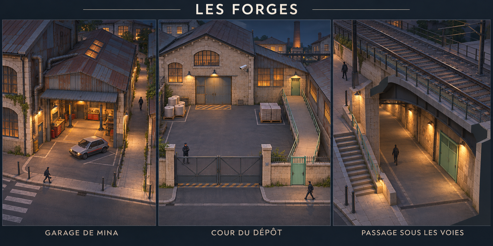

# Direction artistique

## Direction proposée

**Polar industriel charentais en 3D stylisée.** Des murs de calcaire clair, des voies ferrées, des toits simples et des ateliers en tôle forment la base. Le futur se lit dans les portiques, les gilets de surveillance, la signalétique et les façades réemployées. Garder les circulations lisibles en vue haute, même de nuit.

## Références à ouvrir

| Référence | Exemple visuel à regarder | Application |
|---|---|---|
| [The Ascent — galerie officielle](https://store.steampowered.com/app/979690/The_Ascent/) | Rues industrielles en vue haute, façades éclairées par zones, portes et enseignes au milieu d’un décor dense. | Construire une rue où chaque seuil est lisible grâce à la lumière. Garder les effets volumétriques pour quelques cadrages. |
| [Skillshot City — galerie officielle](https://store.steampowered.com/app/308600/Skillshot_City/) | Échelle des véhicules et des piétons, grandes surfaces de chaussée, combat vu d’en haut. | Vérifier les proportions de la voiture, du joueur et des obstacles depuis la distance réelle de jeu. |
| [Plan touristique illustré d’Angoulême](https://www.angouleme-tourisme.com/wp-content/uploads/2022/01/Anguleme-en-Balade-2023-FR.pdf) | Trame de rues, rapport entre gare, ville basse, remparts et Plateau. | Donner à chaque quartier une silhouette et condenser les liaisons pour différencier marche et conduite. |
| [Musée du Papier d’Angoulême](https://maam.angouleme.fr/votre-visite/parcours-de-visite/) | Anciennes papeteries du Nil et réemploi du patrimoine industriel. | Concevoir le dépôt comme un bâtiment ancien doté d’un quai logistique et d’extensions récentes. |

## Palette de travail

Les codes sont des points de départ à tester en jeu. Chaque signal interactif dispose aussi d’une forme ou d’une icône.

| Zone | Bases | Accents et repères |
|---|---|---|
| **Les Forges** | Asphalte bleu-gris `#252E35`, calcaire `#B7AA93`, acier `#58676D`. | Ambre `#FFC370` pour les ateliers, vert `#82D9AF` pour les accès de service. |
| **La Dalle** | Béton ocre `#8D796E`, enduit `#CBBEAD`. | Fenêtres chaudes, rideaux et bâches aux couleurs variées pour identifier les paliers. |
| **Le Nœud** | Ardoise `#303744`, pierre claire `#D6DCE1`. | Blanc froid pour le contrôle institutionnel et rouge `#ED6562` pour la détection confirmée. |

## Règles au cadrage de jeu

- **Joueur et vigiles.** Pour le coursier, veste claire et sac plat contrasté. Pour les vigiles, épaules plus carrées et bandeau de casque. Mina s’identifie par sa combinaison d’atelier et une lampe de poitrine.
- **Véhicule.** Toit et capot de valeurs différentes, sangles ou outils visibles derrière l’habitacle, feux de freinage distincts.
- **Accès.** Un seuil éclairé et une ouverture forment un repère. L’escalier reste visible depuis le trottoir. Le tablier des voies s’efface dans son volume de masquage et laisse la pente et les garde-corps visibles.
- **Implants et impacts.** Intrusion éteint un voyant. Leurre produit un anneau bref. Le sang se lit sur le point d’impact et au sol avec des particules et traces réutilisées. Tester la lisibilité en mouvement au zoom normal.

## Première planche de production

Préparer trois captures issues du même îlot Three.js, à caméra et échelle identiques. **Garage et rue d’ateliers** pour tester silhouettes et signalétique. **Cour et dépôt** pour tester les deux entrées et la caméra de surveillance. **Pont et passage inférieur** pour comparer les niveaux, à pied puis en voiture.

Le premier kit comprend un mur de pierre, une façade d’atelier, une grille, un quai, un escalier, un tablier, une voiture et trois silhouettes. Vérifier d’abord la lecture en niveaux de gris, puis les contrastes de nuit. Mesurer la fluidité sur le trajet de fuite avec les ombres et les effets d’impact actifs.

## Planche de concepts — Les Forges

Le garage associe une baie d’atelier ambre à une ruelle piétonne. Au dépôt, la grille verte signale l’accès de service à côté du portail principal. Sous les voies, la coupe du tablier illustre la visibilité à obtenir quand le joueur descend l’escalier. Les proportions et le cadrage restent à vérifier dans la scène jouable Three.js.
