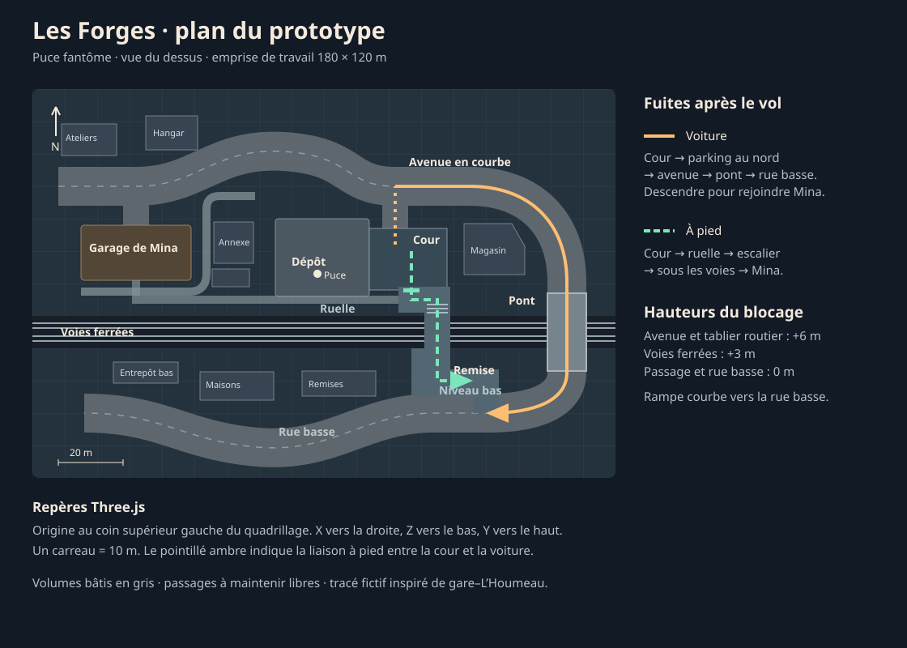

# Les Forges — Plan de blocage Three.js

## Implantation

Coordonnées en mètres dans l’ordre **X, Y, Z**. Origine au coin nord-ouest du plan. Conversion depuis le dessin : retirer (40, 110) aux pixels du SVG puis diviser par quatre pour obtenir X et Z. Les valeurs sont proposées pour le blocage.

| Repère | X, Y, Z | Implantation |
|---|---|---|
| Garage de Mina | 32, 6, 50 | Atelier de 34 × 17 m. Sortie voiture vers l’avenue. |
| Dépôt | 89, 6, 52 | Bâtiment de 29 × 24 m. Placer la puce à 88, 6, 57. |
| Cour | 116, 6, 52 | Espace d’environ 24 × 19 m. Accès nord principal, sortie sud piétonne. |
| Parking de fuite | 112, 6, 30 | Prévoir une place en retrait de l’avenue, reliée à l’entrée de la cour. |
| Franchissement routier | 165, 6, 75 | Chaussée de 12 m. Tablier à hauteur constante jusqu’à Z = 87. Rampe courbe depuis (165, 6, 87) vers (141, 0, 100). Le profil suit la distance parcourue le long de la chaussée. |
| Escalier | 125, 6 → 0, 65 → 70 | Départ depuis la ruelle. Descente à réaliser en deux volées avec palier, ou en rampe de collision pour la première itération. |
| Passage et remise | 125, 0, 75 → 135, 0, 90 | Tunnel piéton de 8 m. Mina attend au-delà des voies, accessible depuis la rue basse. |
| Arrêt voiture | 141, 0, 100 | Créer une zone d’arrêt et une liaison piétonne jusqu’à Mina. |

## Montage et recette

1. Poser les collisions des volumes, les chaussées et les deux traversées. Dans Rapier, garder distinctes la surface du pont, les voies à Y = 3 et le sol du passage inférieur. Fermer l’accès aux voies pour ce prototype.
2. Découper le tablier ferroviaire au-dessus du tunnel en élément visuel séparé. Le masquer ou l’estomper avec un volume déclencheur au niveau bas. Laisser sa collision inchangée.
3. Tester les deux sorties depuis la puce. À pied, passer par la cour, l’escalier et le tunnel. En voiture, rejoindre le véhicule au nord, franchir le pont, descendre la rampe et stationner sur la rue basse.
4. Tester la remise à pied près de Mina après cinq secondes sans détection confirmée. Les vigiles doivent suivre les liaisons praticables entre niveaux sans couper à travers les voies.
5. Ajouter le raccourci déblocable vers les ateliers après avoir validé les deux itinéraires initiaux. Le plan situe les accès du prototype avant cette ouverture.

## Tracé et implantation

- Avenue nord en S entre le garage et la cour. À l’est de la cour, l’avenue s’infléchit vers le pont. En sortie de pont, la rampe tourne vers la rue basse, qui serpente devant les îlots du sud.
- Dans Three.js, utiliser les courbes du SVG comme base du tracé. Échantillonner l’axe et générer les bords à partir de la tangente locale. Garder 12 m de chaussée sur le trajet automobile et prévoir 2 m de trottoir de chaque côté hors tablier. Utiliser le même tracé échantillonné pour la géométrie et les collisions de chaussée.
- Les volumes secondaires du plan matérialisent les îlots. Positionner les façades derrière le trottoir et vérifier les débords des auvents, clôtures, escaliers et accessoires. Vérifier les volumes en 3D, à chaque hauteur.
- Réserver les approches du pont, la rampe, la place de stationnement, l’accès nord de la cour et les deux extrémités du tunnel. Aucun volume bâti ou décor solide ne doit empiéter sur les gabarits libres à ces endroits. Garder la cour et la ruelle traversables à pied.
- Valider au gabarit de la voiture, en roulant dans les deux sens, en prenant les virages et en entrant puis sortant du garage. Vérifier aussi que la voiture peut s’arrêter côté rue basse tout en laissant la liaison vers Mina praticable à pied.

## Collisions et dégâts visibles

Chaque nouvel impact de la voiture contre un obstacle solide, un véhicule, un élément de mobilier ou un personnage doit produire des dégâts visibles sur au moins un des éléments touchés. Graduer la réaction selon la vitesse relative au point de contact et le type d’objet.

| Impact | Effet à produire |
|---|---|
| Accrochage léger contre un mur ou garde-corps | Rayure ou petite marque sur la carrosserie, localisée du côté touché. |
| Choc moyen contre un obstacle ou une voiture | Bosse, pièce d’habillage déplacée ou phare fissuré. Ajouter une réaction sur l’autre véhicule s’il est mobile. |
| Choc grave | Déformation plus marquée, phare cassé ou pièce détachée, selon la zone touchée. |
| Mobilier fragile | Objet plié, cassé ou déplacé selon sa résistance. |
| Personnage renversé | Réaction visible au choc. Éclaboussures et traces de sang lors des collisions graves. |

Distinguer le début d’un impact d’un contact qui persiste. Un frottement peut prolonger une rayure, tandis qu’un véhicule immobilisé contre un mur conserve son état. Les contacts normaux des pneus avec la chaussée et les volumes de déclenchement servent à la conduite et à la mission. Conserver les dégâts visibles jusqu’à la reprise ou à la réinitialisation du véhicule dans le prototype.

**Recette.** Frôler un garde-corps, heurter une façade avec l’avant, toucher une borne et renverser un personnage de test. Vérifier le côté touché, la différence entre choc léger et grave, et la stabilité des dégâts lorsque la voiture reste en appui.

## Population des Forges

Viser 8 à 14 passants et 2 à 4 véhicules visibles sur l’axe animé, en plus des personnages de mission. Prévoir des trajets entre les ateliers, le dépôt et les voies. Tester cette densité pendant les deux fuites. Voir [Ville vivante](07-ville-vivante.md).
