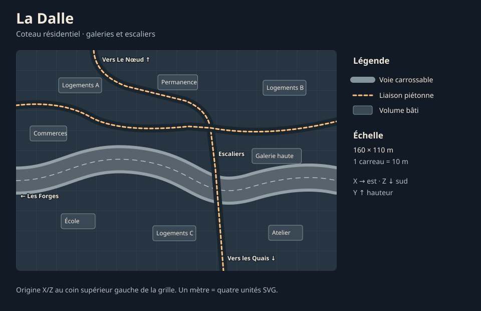
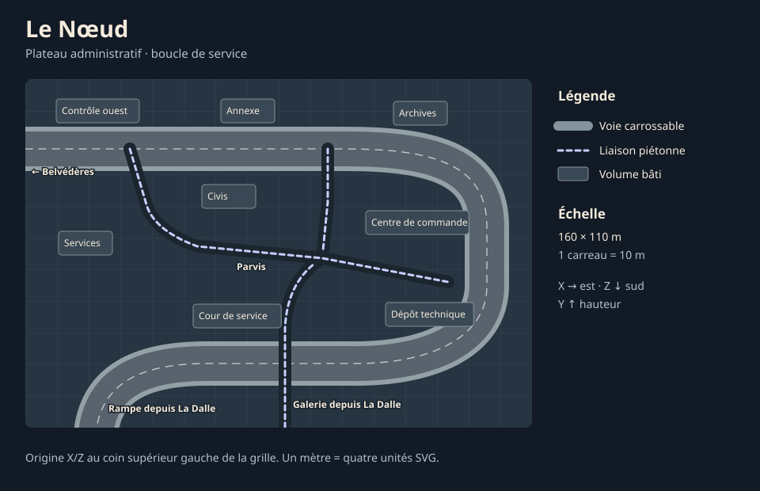
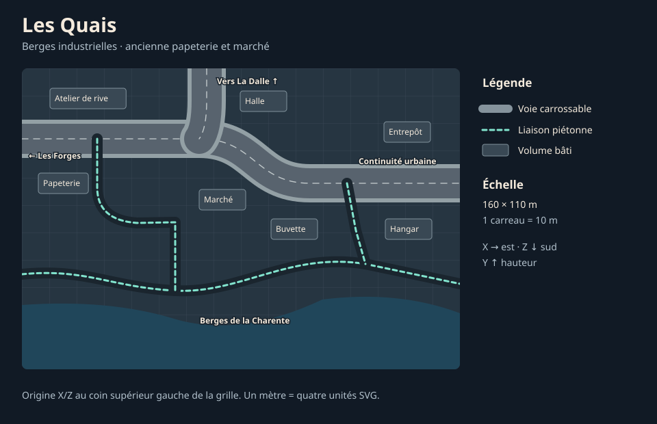
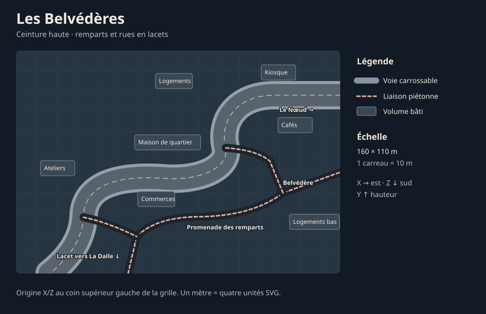

# Plans de quatre quartiers supplémentaires

Les Forges restent le quartier du prototype « Puce fantôme ». Ces quatre plans étendent la ville avec deux quartiers de campagne déjà nommés et deux secteurs nouveaux. Les emprises, dénivelés et jonctions sont des propositions de blocage à régler en roulant et à pied.

| Liaison | Usage |
|---|---|
| Les Forges ↔ La Dalle | Rue montante à l’ouest de La Dalle et liaison piétonne parallèle. |
| Les Forges ↔ Les Quais | Chaussée de rive par l’ouest des Quais. |
| Les Quais ↔ La Dalle | Rue du coteau au nord des Quais et liaison vers les paliers bas. |
| La Dalle ↔ Le Nœud | Rampe routière et galerie distincte vers le plateau. |
| La Dalle ↔ Les Belvédères | Lacets routiers vers les remparts et terrasses piétonnes. |
| Les Belvédères ↔ Le Nœud | Avenue de ceinture à hauteur constante. |

Les embranchements de La Dalle vers Les Belvédères et vers la rampe du Nœud partent de sa voie de coteau et se prolongent par des tronçons de raccordement. Les plans sont des scènes locales. Dans Three.js, conserver pour chaque sortie un identifiant, un point d’arrivée apparié, une orientation, une altitude et une largeur compatibles. La sortie « Continuité urbaine » des Quais constitue une réserve de raccordement.

## La Dalle

La route du coteau reste à Y = 4 m. Les galeries piétonnes passent progressivement de Y = 0 au sud à Y = 12 au nord par des paliers. Positionner les rampes et escaliers sur les liaisons piétonnes. La permanence de Nadia dessert M03 et U02. Aux heures actives, les résidents convergent vers l’école, les commerces et la permanence. Le soir, les échanges se déplacent vers les halls.

## Le Nœud

Le plateau reste à Y = 12 m. L’entrée sud-ouest prolonge la voie du coteau par une rampe. La galerie piétonne arrive séparément, dans le prolongement de la filière Nadia. L’annexe reçoit la filière Sorel. Les flux alternent entre employés en déplacement, visiteurs qui attendent et équipes de relève. Après M06, actualiser les guichets et les contrôles selon la fin.

## Les Quais

Le quai haut reste à Y = 2 m. La promenade basse à Y = 0 m se raccorde par deux rampes piétonnes. La papeterie accueille U04 près de la limite des Forges. Donner à la halle un cycle d’ouverture et de fermeture ; les files et attroupements doivent se former hors chaussée.

## Les Belvédères

La chaussée descend de Y = 12 m à l’est à Y = 4 m au sud, en suivant l’axe du lacet. La promenade piétonne relie les terrasses par paliers et offre une seconde liaison vers La Dalle. Les cafés et les bancs alternent occupation et départs. Le belvédère accueille des promeneurs même lorsqu’aucun contrat n’est actif.

## Montage commun

- Les courbes suivent les pentes, les berges et les remparts. Construire la chaussée, les trottoirs et leurs collisions à partir du même axe. Prendre comme point de départ 11 m de chaussée et 1,5 m de trottoir de chaque côté, à adapter aux voies de service.
- Les volumes bâtis indiquent les implantations. Garder libres les chaussées, ponts, rampes, trottoirs et seuils. Contrôler aussi les auvents, clôtures et éléments de mobilier. Vérifier les traversées à plusieurs hauteurs et au gabarit du véhicule.
- Avant de détailler les façades, tester chaque liaison dans les deux sens. Les collisions solides reprennent les règles de dégâts visibles du [plan des Forges](05-plan-map-les-forges.md).
- Placer les lieux de fréquentation sur les trottoirs, les parvis et les places. Voir [Ville vivante](07-ville-vivante.md) pour les flux et les objectifs de densité.
