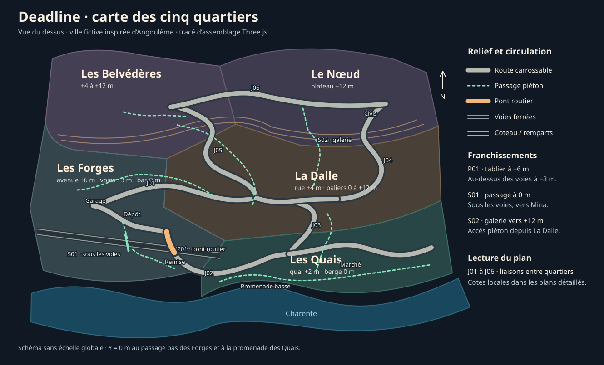

# Carte globale — Les cinq quartiers

Carte d’assemblage vue du dessus. Les positions relatives sont proposées pour raconter la montée depuis les berges jusqu’au plateau. Les [plans des quartiers](06-plans-des-quartiers.md) et le [plan des Forges](05-plan-map-les-forges.md) donnent les cotes de blocage locales. La carte globale n’a pas d’échelle métrique.

## Jonctions à raccorder dans Three.js

| ID | Jonction | Profil et accès |
|---|---|---|
| J01 | Les Forges ↔ La Dalle | Rue en courbe de l’avenue à +6 m vers la rue du coteau à +4 m. Liaison piétonne parallèle. |
| J02 | Les Forges ↔ Les Quais | Reprendre la rue basse à 0 m au sud du pont. Remonter progressivement vers le quai haut à +2 m. |
| J03 | Les Quais ↔ La Dalle | Rue montante du quai à +2 m vers le coteau à +4 m. Un accès piéton rejoint les paliers bas depuis la promenade à 0 m. |
| J04 | La Dalle ↔ Le Nœud | Rampe routière de +4 à +12 m. La galerie piétonne S02 rejoint le plateau par une entrée distincte liée à la filière Nadia. |
| J05 | La Dalle ↔ Les Belvédères | Lacets de +4 m jusqu’aux rues de ceinture. Terrasses accessibles à pied depuis les paliers du coteau. |
| J06 | Les Belvédères ↔ Le Nœud | Avenue de ceinture à +12 m. Prévoir un trottoir continu le long de la liaison. |

## Franchissements et vérification

- **P01, pont routier des Forges.** Tablier à +6 m au-dessus des voies à +3 m, puis rampe courbe vers la rue basse à 0 m. Il sert à la fuite en voiture de « Puce fantôme ».
- **S01, passage sous les voies.** La fuite à pied descend depuis la cour du dépôt et rejoint Mina à 0 m. Masquer le tablier ferroviaire en vue haute selon la position du joueur. Dans Rapier, préserver les collisions des surfaces à leur hauteur respective.
- **S02, galerie du coteau.** Accès piéton au plateau avec des paliers. Garder distincts son arrivée et celle de la rampe routière.
- **Montage.** Placer deux points de raccordement appariés par jonction avec position, altitude, orientation et largeur utiles. Construire les virages et les rampes avant les volumes bâtis. Les routes, trottoirs et ponts conservent leurs gabarits libres. Relier séparément les graphes piéton et automobile pour les habitants, le trafic et les poursuites.
- **Recette.** Rouler la boucle Forges → Dalle → Belvédères → Nœud → Dalle → Quais → Forges, puis vérifier les raccordements dans l’autre sens. Rejouer les deux fuites des Forges après le montage de la ville.
